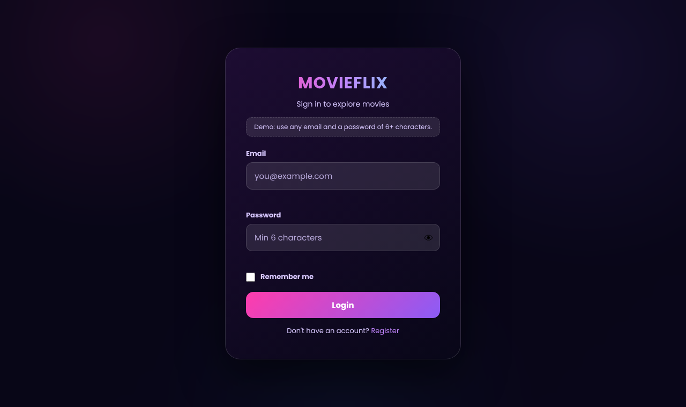
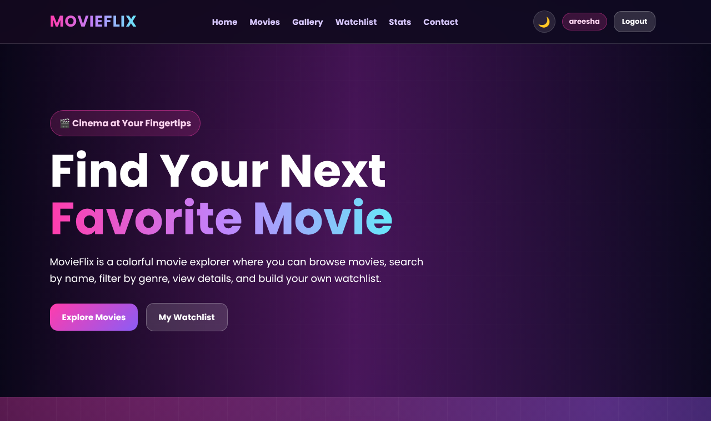
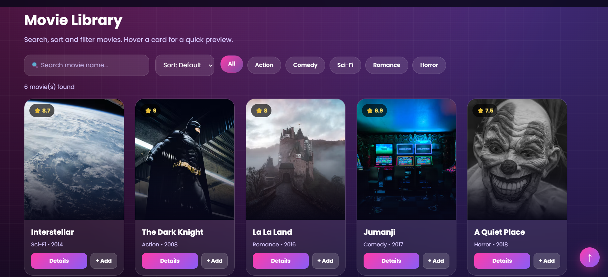
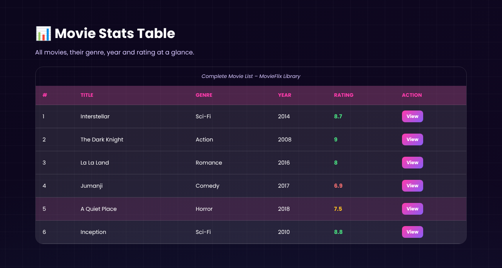

# MovieFlix

A colourful movie explorer website where you can browse movies, search by name, filter by genre, sort, view details and build your own watchlist.

I built this project for my **Web Engineering** course in the BS Software Engineering programme at the University of Gujrat, using only HTML, CSS and JavaScript.

**Live demo:** https://areeshakhadim.github.io/MovieFlix/
*(Demo login: use any email and a password of 6+ characters.)*

## Screenshots

| Login | Home |
|---|---|
|  |  |

| Movie library | Stats table |
|---|---|
|  |  |
## Features

- **Login and register forms** with input validation (email format, password length, matching passwords)
- **Search** movies by name as you type
- **Filter** by genre and **sort** by rating, year or title
- **Movie details** popup
- **Watchlist** that is saved in the browser (localStorage), so it stays after a refresh
- **Image gallery** with a full-screen lightbox (use the arrow keys to move between images)
- **Stats table** with colour-coded ratings
- **Live weather** for Gujrat from the Open-Meteo Web API
- **Contact form** with validation
- **Dark and light mode**
- Animations, toast messages and a responsive layout for phones

## Built with

- HTML5 (semantic tags, accessibility labels)
- CSS3 (CSS variables, grid, flexbox, animations, media queries)
- JavaScript (DOM, events, array methods, localStorage, Fetch API)
- [Open-Meteo API](https://open-meteo.com/) for weather

## How to run

No installation needed. Download the files and open `index.html` in a browser, or use the live demo link above.

## Changelog

- 2026: improved text contrast in light mode, added a demo-login hint, and set the weather to show Gujrat.

## Author

**Areesha Khadim**, BS Software Engineering, University of Gujrat
